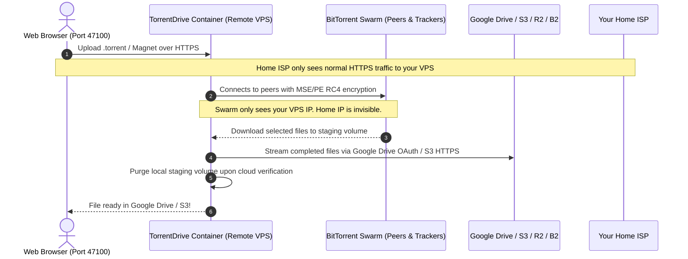

# TorrentDrive

<p align="center">
  <strong>ISP-Blind, Self-Hosted Torrent-to-Google Drive &amp; S3 Cloud Downloader</strong>
</p>

<p align="center">
  <a href="https://github.com/TorrentDrive/backend/blob/main/LICENSE"></a>
  <a href="https://github.com/TorrentDrive/backend/pkgs/container/torrentdrive"></a>
  <a href="https://tc.gitnasr.com/docs"></a>
  <a href="https://dotnet.microsoft.com/"></a>
  <a href="https://nextjs.org/"></a>
  
</p>

---

**TorrentDrive** is an open-source, self-hosted cloud torrent downloader and seedbox that downloads BitTorrent swarms on your remote VPS and streams finished files directly into **Google Drive**, **AWS S3**, **Cloudflare R2**, **Backblaze B2**, **Wasabi**, or **MinIO** over encrypted HTTPS.

Your home IP connection **never joins a BitTorrent swarm** and never contacts public or private trackers. Your ISP only ever sees standard outbound HTTPS traffic.

One zero-configuration Docker container. No local disk wear. No subscription fees.

---

## ⚡ Install in One Command

Linux / macOS:

<!-- snippet:install-linux -->
```bash
curl -fsSL https://raw.githubusercontent.com/TorrentDrive/backend/main/install.sh | bash
```
<!-- /snippet -->

Windows (PowerShell):

<!-- snippet:install-windows -->
```powershell
irm https://raw.githubusercontent.com/TorrentDrive/backend/main/install.ps1 | iex
```
<!-- /snippet -->

Docker Compose (Zero `.env` Required):

```bash
curl -fsSL https://raw.githubusercontent.com/TorrentDrive/backend/main/docker-compose.yml -o docker-compose.yml && docker compose up -d
```

> **First Boot**: Open `http://localhost:47100` (or your VPS IP / domain) to launch the 3-step **Setup Wizard** to configure your credentials and storage provider.

---

## 🚀 Why TorrentDrive? (Comparison vs Alternatives)

| Feature | TorrentDrive (Self-Hosted) | Seedr | Real-Debrid | qBittorrent + Rclone |
|---|:---:|:---:|:---:|:---:|
| **Cost** | **100% Free & Open-Source (MIT)** | $9.99 – $19.99 / mo | Paid Subscription | Free (Self-Hosted) |
| **Direct Google Drive Streaming** | ✅ Native OAuth 2.0 streaming | ❌ | ❌ | ⚠️ Complex script config |
| **S3 & Cloudflare R2 Uploads** | ✅ Checkpointed multipart | ❌ | ❌ | ⚠️ Manual rclone mounts |
| **ISP-Blind Stealth Transfers** | ✅ Remote MSE/PE RC4 engine | ✅ | ✅ | ⚠️ Manual client settings |
| **Private Trackers (BEP 27)** | ✅ Strict isolation (no DHT/PEX leak) | ❌ | ❌ | ⚠️ Requires manual rules |
| **Selective Batch File Picking** | ✅ Live swarm health & file picking | ⚠️ Limited on free tiers | ❌ | ✅ Manual |
| **Storage Limits** | **Unlimited** (use your own cloud) | 2 GB – 1 TB quota | Link expiry limits | Disk-dependent |
| **Privacy & Sovereignty** | **100% Self-Hosted** (Zero relay) | ❌ Third-party servers | ❌ Third-party servers | ✅ Self-Hosted |
| **1-Click PaaS Blueprints** | ✅ Dokploy & Coolify templates | ❌ | ❌ | ❌ |

---

## 🛠️ Architecture & How It Works



---

## 🌟 Core Features

- **🛡️ 100% ISP-Blind Stealth Engine**: BitTorrent peer connections and tracker announces execute entirely on your remote VPS. Enforces MSE/PE RC4 stream encryption and VPN interface binding.
- **☁️ Direct Cloud Streaming to Google Drive & S3**: Upload directly to Google Drive via OAuth 2.0, or S3-compatible providers (AWS S3, Cloudflare R2 with zero egress fees, Backblaze B2, Wasabi, MinIO) with checkpointed multipart uploads that survive restarts.
- **🔒 Strict BEP 27 Private Tracker Isolation**: Automatically disables DHT, Peer Exchange (PEX), and Local Peer Discovery (LPD) whenever a private torrent is loaded, protecting private tracker ratios and accounts.
- **📊 Live Swarm Health & File Picking**: Inspect live seeders, leechers, and swarm health scores via BEP 15 UDP and BEP 48 HTTP tracker scrapers before downloading. Select only the specific files you want.
- **🔄 Auto Storage Failover & Purge**: Automatically tests storage health and routes uploads to backup drives if primary storage fills up. Automatically purges finished local files to prevent disk exhaustion.
- **📦 Zero-Config All-In-One Container**: PostgreSQL 15, Redis 7, .NET 9 API, Hangfire background workers, and Next.js frontend packed into a single container (`ghcr.io/torrentdrive/torrentdrive:latest`).
- **🚀 1-Click PaaS Deployment**: Pre-built, tested deployment blueprints for [Dokploy](https://tc.gitnasr.com/docs/paas/dokploy) and [Coolify](https://tc.gitnasr.com/docs/paas/coolify), as well as Render and Railway.

---

## 📖 Repositories & Organization Structure

| Repository | Description | Primary Stack |
|---|---|---|
| 📦 **[TorrentDrive/backend](https://github.com/TorrentDrive/backend)** | .NET 9 Clean Architecture API, MonoTorrent engine, Hangfire orchestrators, Google Drive & S3 upload workers, all-in-one Dockerfile, and PaaS blueprints. | C#, .NET 9, EF Core, Redis, PostgreSQL |
| 💻 **[TorrentDrive/frontend](https://github.com/TorrentDrive/frontend)** | Next.js web application, real-time download and upload progress, setup wizard, file browser, and settings dashboard. | TypeScript, Next.js 16, Tailwind CSS, Radix UI |
| 📚 **[TorrentDrive/website](https://github.com/TorrentDrive/website)** | Official documentation and marketing website, Fumadocs MDX engine, SEO & AI search knowledge graph. | Next.js 16, Fumadocs, Tailwind CSS 4 |

---

## 📚 Documentation & Guides

Comprehensive documentation is hosted at **[tc.gitnasr.com/docs](https://tc.gitnasr.com/docs)**:

- [Getting Started & Installation](https://tc.gitnasr.com/docs/getting-started)
- [First Run Setup Wizard](https://tc.gitnasr.com/docs/first-run)
- [Connecting Google Drive](https://tc.gitnasr.com/docs/providers/google-drive)
- [Connecting S3, Cloudflare R2 & Backblaze B2](https://tc.gitnasr.com/docs/providers/s3)
- [Dokploy 1-Click Deployment](https://tc.gitnasr.com/docs/paas/dokploy)
- [Coolify 1-Click Deployment](https://tc.gitnasr.com/docs/paas/coolify)
- [Architecture & Security Blueprint](https://tc.gitnasr.com/docs/architecture)
- [Frequently Asked Questions (FAQ)](https://tc.gitnasr.com/docs/faq)
- [Machine-Readable LLM Index (llms.txt)](https://tc.gitnasr.com/llms.txt)
- [Machine-Readable Pricing & Specs (pricing.md)](https://tc.gitnasr.com/pricing.md)

---

## 🤝 Contributing

We welcome contributions, bug reports, and feature suggestions!
- Read our [Contributing Guide](https://github.com/TorrentDrive/.github/blob/main/CONTRIBUTING.md) to understand repo relationships and workflow.
- Report security issues privately per our [Security Policy](https://github.com/TorrentDrive/.github/blob/main/SECURITY.md).

---

## 📄 License

TorrentDrive is free and open-source software licensed under the **[MIT License](https://github.com/TorrentDrive/backend/blob/main/LICENSE)**.
