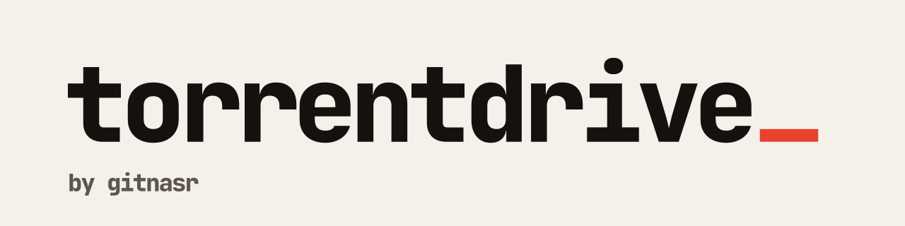
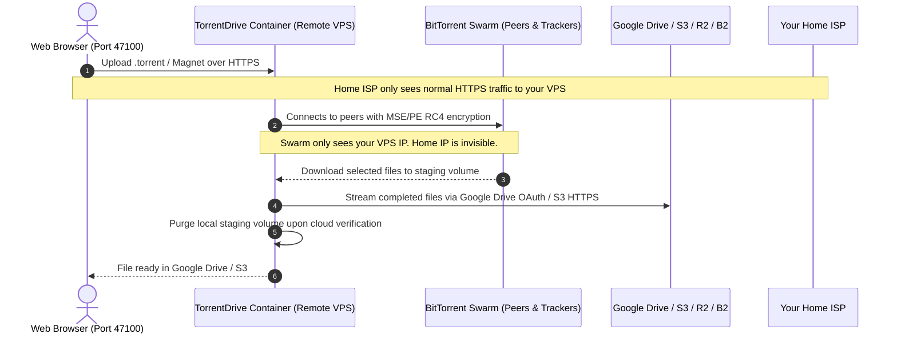

<picture>
  <source media="(prefers-color-scheme: dark)" srcset="assets/banner-dark.svg">
  
</picture>

A self-hosted torrent downloader that sends finished files straight to Google Drive or S3. The torrent traffic runs on your own VPS, so your home connection never joins a swarm and your ISP only sees HTTPS.

<p>
  <a href="https://tc.gitnasr.com/docs"><b>Documentation</b></a> ·
  <a href="https://tc.gitnasr.com">Website</a> ·
  <a href="https://github.com/TorrentDrive/backend">Source</a> ·
  <a href="https://github.com/TorrentDrive/backend/blob/main/LICENSE">MIT License</a>
</p>

## Install

Linux and macOS:

<!-- snippet:install-linux -->
```bash
curl -fsSL https://raw.githubusercontent.com/TorrentDrive/backend/main/install.sh | bash
```
<!-- /snippet -->

Windows (PowerShell):

<!-- snippet:install-windows -->
```powershell
irm https://raw.githubusercontent.com/TorrentDrive/backend/main/install.ps1 | iex
```
<!-- /snippet -->

Docker Compose, no `.env` needed:

```bash
curl -fsSL https://raw.githubusercontent.com/TorrentDrive/backend/main/docker-compose.yml -o docker-compose.yml && docker compose up -d
```

Then open `http://localhost:47100` (or your VPS address). A three-step setup wizard asks for your credentials and storage provider.

## How it works



Storage targets: Google Drive, AWS S3, Cloudflare R2, Backblaze B2, Wasabi and MinIO.

## What you get

- **Private from your ISP.** Peer connections and tracker announces happen on the VPS. MSE/PE RC4 encryption is enforced, and traffic can be bound to a VPN interface.
- **Direct to cloud.** Google Drive over OAuth 2.0, or any S3-compatible provider, with multipart uploads that resume after a restart.
- **Private tracker safe.** When a private torrent is loaded (BEP 27), DHT, PEX and LPD are turned off so your ratio and account are not exposed.
- **Pick before you download.** Live seeders, leechers and a health score from BEP 15 UDP and BEP 48 HTTP scrapes, then choose only the files you want.
- **Storage failover.** If the primary storage fills up, uploads move to a backup. Finished local files are purged after the cloud copy is verified.
- **One container.** PostgreSQL 15, Redis 7, the .NET 9 API, Hangfire workers and the Next.js frontend ship together as `ghcr.io/torrentdrive/torrentdrive:latest`.
- **PaaS templates.** Ready for [Dokploy](https://tc.gitnasr.com/docs/paas/dokploy), [Coolify](https://tc.gitnasr.com/docs/paas/coolify), Render and Railway.

## How it compares

| | TorrentDrive | Seedr | Real-Debrid | qBittorrent + Rclone |
| --- | --- | --- | --- | --- |
| Cost | Free, MIT | $9.99 to $19.99 per month | Subscription | Free |
| Where it runs | Your server | Their servers | Their servers | Your server |
| Direct Google Drive upload | Yes, native OAuth | No | No | Manual script |
| S3 and R2 upload | Yes, multipart | No | No | Manual rclone mounts |
| Private tracker isolation | Yes, automatic | No | No | Manual rules |
| Pick files from live swarm data | Yes | Limited on free tiers | No | Manual |
| Storage limit | Your own cloud | 2 GB to 1 TB | Link expiry | Your disk |
| One-click PaaS templates | Dokploy, Coolify | No | No | No |

## Repositories

| Repository | What it is | Stack |
| --- | --- | --- |
| [backend](https://github.com/TorrentDrive/backend) | API, torrent engine, Hangfire workers, upload workers, all-in-one Dockerfile, PaaS templates | C#, .NET 9, EF Core, PostgreSQL, Redis |
| [frontend](https://github.com/TorrentDrive/frontend) | Web dashboard: setup wizard, live progress, file browser, settings | TypeScript, Next.js 16, Tailwind CSS, Radix UI |
| [website](https://github.com/TorrentDrive/website) | Docs and marketing site at [tc.gitnasr.com](https://tc.gitnasr.com) | Next.js 16, Fumadocs, Tailwind CSS 4 |

## Docs

[Getting started](https://tc.gitnasr.com/docs/getting-started) ·
[Setup wizard](https://tc.gitnasr.com/docs/first-run) ·
[Google Drive](https://tc.gitnasr.com/docs/providers/google-drive) ·
[S3, R2 and B2](https://tc.gitnasr.com/docs/providers/s3) ·
[Architecture and security](https://tc.gitnasr.com/docs/architecture) ·
[FAQ](https://tc.gitnasr.com/docs/faq) ·
[llms.txt](https://tc.gitnasr.com/llms.txt)

## Contributing

Read the [contributing guide](https://github.com/TorrentDrive/.github/blob/main/CONTRIBUTING.md). Report vulnerabilities privately, as described in the [security policy](https://github.com/TorrentDrive/.github/blob/main/SECURITY.md).

Made by [gitnasr](https://gitnasr.com). MIT licensed.
